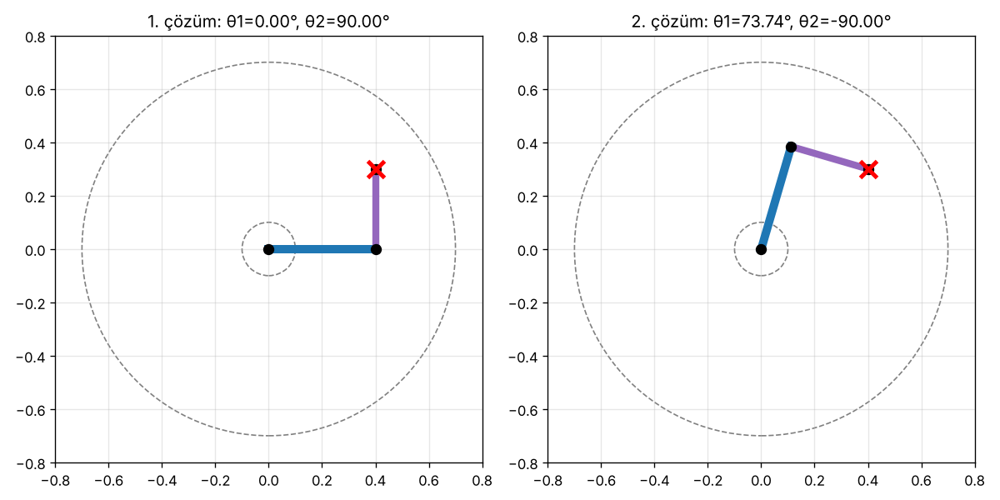

# 2R robot kol: ileri ve ters kinematik

Düzlemsel iki dönel eklemli (2R) robot kolunun ileri ve ters kinematiği, **3 boyutlu etkileşimli bir sahne** ile. Kol masanın üstünde duran gerçek bir nesne gibi gösterilir, açılar masaya çizilmiş renkli yaylarla işaretlenir. Python kodu, matplotlib çizimi ve adım adım anlatım sayfası da var.

## 3D etkileşimli sahne

**Dosya: [`web/kol3d.html`](web/kol3d.html)**. Dosyayı indirip tarayıcıda aç (GitHub'da tıklayınca çalışmaz, sadece kod görünür; three.js internetten yüklendiği için bağlantı gerekir).

**Sahnede ne var**
- Mavi kol 1. kol, mor kol 2. kol. Bağlantılar silindir olarak çizilir, kol masanın üstünde durur.
- **Silik kol** aynı hedefin öbür ters kinematik çözümüdür. Dalı değiştirince kol dirseğini çevirerek öbür çözüme geçer.
- **Kırmızı iğne** hedeftir. Kolun ucu iğnenin tepesiyle üst üste gelince hedefe ulaşılmış olur.
- **Yeşil halka** ulaşılabilir alandır: 0.1 m ≤ r ≤ 0.7 m.

**Açı yayları** (alttaki düğmelerle tek tek açılıp kapatılır)

| Renk | Açı | Nerede ölçülür |
|---|---|---|
| Mavi | θ₁ | x ekseni ile 1. kol arası |
| Mor | θ₂ | 1. kolun uzantısı (gri kesikli) ile 2. kol arası |
| Magenta | φ | x ekseni ile tabandan hedefe giden çizgi arası |
| Kahve | β | 1. kol ile tabandan hedefe giden çizgi arası |

**Neler yapabilirsin**
- **Sahneyi çevir:** boş yere basıp sürükle. Kamera düğmeleri: 3D, Üstten, Yandan. Fare tekerleği ile yakınlaştır.
- **Hedefi sürükle:** kırmızı iğneyi taşı. Altındaki hesap kartı c₂, θ₂, φ, β ve θ₁ değerlerini canlı günceller.
- **Dal seç:** 1. dal (θ₂ pozitif) ve 2. dal (θ₂ negatif) arasında geçiş yap.
- **Hazır hedefler:** "c şıkkı" (0.4, 0.3) ve "d şıkkı" (0.8, 0) düğmeleri. d şıkkında hedef halkanın dışına çıkar, kol kırmızıya döner ve kart `|c₂| > 1` yazar.
- **İleri kinematik:** "Açı ver" sekmesinde θ₁ ve θ₂ kaydırıcılarıyla kolu elle çevir. θ₂'nin 1. kola göre ölçüldüğünü, θ₁ değişince 2. kolun da onunla döndüğünü gör.

**İki çözüm yan yana (matplotlib çıktısı)**



## Örnek soru

**Soru 6. İki eklemli robot kolunda ileri ve ters kinematik**

> Düzlemsel iki dönel eklemli (2R) kolun uzunlukları L₁ = 0.4 m, L₂ = 0.3 m'dir. θ₁ = 30°, θ₂ = 60°; ikinci açı birinci kola göredir. Eklem limitleri yoktur.
>
> a) Uç noktanın taban çerçevesindeki konumunu bulunuz.
> b) Ulaşılabilir radyal aralığı türetiniz.
> c) Hedef p = [0.4, 0.3]ᵀ m için iki ters kinematik çözümünü bulunuz.
> d) [0.8, 0]ᵀ m hedefinin ulaşılabilirliğini inceleyiniz ve bir çözümü ileri kinematikle doğrulayınız.

### Çözüm özeti

**a) İleri kinematik.** θ₂ birinci kola göre ölçüldüğü için ikinci kolun yere göre açısı θ₁ + θ₂'dir.

```
x = L₁cos θ₁ + L₂cos(θ₁+θ₂) = 0.4·cos 30° + 0.3·cos 90° ≈ 0.346 m
y = L₁sin θ₁ + L₂sin(θ₁+θ₂) = 0.4·sin 30° + 0.3·sin 90° = 0.5 m
```

**b) Çalışma uzayı.** Kol tamamen açıkken en uzak, tamamen katlanmışken en yakın konuma ulaşır:

```
|L₁ − L₂| ≤ r ≤ L₁ + L₂   →   0.1 m ≤ √(x²+y²) ≤ 0.7 m
```

**c) Ters kinematik, hedef (0.4, 0.3).**

```
r = 0.5 m                                   (0.1 ile 0.7 arasında, ulaşılabilir)
c₂ = cos θ₂ = (x²+y²−L₁²−L₂²) / (2L₁L₂) = 0
s₂ = ±√(1−c₂²) = ±1                         → θ₂ = +90° veya −90°
φ = atan2(y, x) = 36.87°                    (hedefin yön açısı)
β = atan2(L₂s₂, L₁+L₂c₂)                    (ilk kol ile hedef arasındaki açı)
θ₁ = φ − β
```

| Dal | θ₂ | β | θ₁ |
|---|---|---|---|
| 1 | +90° | 36.87° | 0° |
| 2 | −90° | −36.87° | 73.74° |

İki çözüm: **(θ₁, θ₂) = (0°, 90°)** ve **(73.74°, −90°)**. İkisi de uç noktayı (0.4, 0.3)'e götürür, ama uç kolun yönü farklıdır: aynı konum, farklı pose.

**d) Ulaşılamayan hedef (0.8, 0).** Uzaklık 0.8 m, kolun erişimi 0.7 m. Aynı formül c₂ = 1.625 verir. Kosinüs [−1, 1] dışına çıkamayacağı için gerçek bir çözüm yoktur: **|c₂| > 1 ise hedefe ulaşılamaz.**

**Sık hatalar**
- İkinci kolun katkısını L₂cos θ₂ yazmak. Doğrusu L₂cos(θ₁+θ₂).
- atan(y/x) kullanmak. atan2(y, x) doğru çeyreği seçer.
- c₂ = 1.625 gibi büyük bir değeri 1'e kırpmak. Kırpma sadece 1 + 10⁻¹² gibi yuvarlama taşmaları içindir ve ulaşılabilirlik kontrolünden sonra yapılır.

## Dosyalar

| Dosya | Ne yapar |
|---|---|
| `robot_kol.py` | `ileri(t1, t2)` ve `ters(x, y)` fonksiyonları, iki hedefle deneme |
| `robot_kol_ciz.py` | İki ters kinematik çözümünü matplotlib ile çizer, `kol.png` kaydeder |
| `web/kol3d.html` | **3D etkileşimli sahne:** döndürülebilir kamera, sürüklenebilir hedef, açı yayları, iki çözüm |
| `web/adim_adim.html` | c şıkkını 9 adımda gösteren 2D etkileşimli anlatım sayfası |

## Çalıştırma

```bash
pip install matplotlib
python robot_kol.py        # iki hedef için çözümleri yazdırır
python robot_kol_ciz.py    # çizimi açar
```

`web/kol3d.html` ve `web/adim_adim.html` dosyalarını tarayıcıda açman yeterli (3D sayfa three.js'i internetten yükler).
